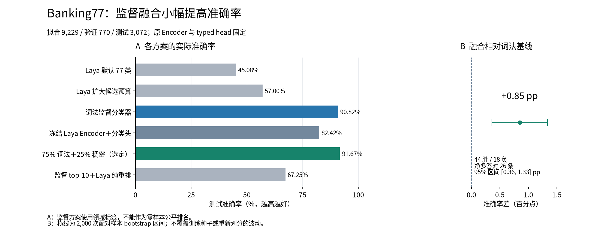
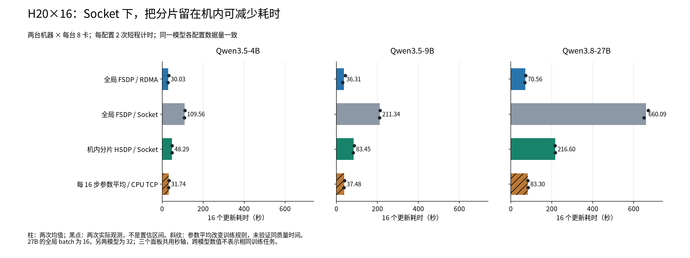

# Jev / Laya 与 H20 / 910B4：从问题读到证据

文档整理于 2026-10-26。这里保存模型质量与训练系统两个独立方向的代码、数据、报告和决策历史。

模型质量问“判断能否做对，概率能否信”；训练系统问“怎样更快完成相同工作”。先选择你想读的问题：

1. 认识模型：[Jev / Laya 原理说明](jev-laya-research-2026-10-18-friendly.md)。
2. 看实际质量：[三轮报告](artifacts/decision_study/REPORT.md) → [Banking77 图解](artifacts/decision_study/REPORT_BANKING77-friendly.md)。
3. 看训练系统：[H20×16 图解](artifacts/16card-experiments/paper/report-friendly.md) → [混合实验后的选择](artifacts/experiment-conclusions-friendly.md)。
4. 查术语与所有文档：[指标说明](artifacts/METRICS.md)、[完整阅读地图](artifacts/README.md)。

## 图与结果

Banking77 拟合 / 验证 / 测试为 9,229 / 770 / 3,072。验证选定的 75% 词法＋25% 冻结 Laya 分类头概率融合为 91.67%，词法基线 90.82%；净多答对 26 条，配对提升区间约 [+0.36,+1.33] 个百分点。它使用领域监督，原 Encoder / typed head 未更新；NLL、Brier、ECE 都比词法差，不能称所有质量指标改善。Jev 本轮没有 API 调用证据，也没有 SOTA 对照。

H20 两机共 16 卡完成三模型、七配置、每配置两次短程计时，以及九个生成 / 更新 case。27B 在 Socket 下，全局 FSDP 为 660.09 秒、机内分片 HSDP 为 216.60 秒。每 16 步参数平均为 83.30 秒，但改变更新规则，没有同质量时间证据。黑点是两次观测，不是置信区间。

历史 4＋4 没有证明混合胜过较快同构。新版 NPU×16 和混合 8＋8 两组于 10 月 25 日确认取消，原三组强比较未完成。不要把原稿当时的排队状态读成当前运行状态。

## 怎样复核与运行

[Banking77 运行说明](artifacts/decision_study/BANKING77_REPRODUCE.md)提供加载保存分类头和重新实验的步骤；[逐样本概率](artifacts/decision_study/results_round3/test_predictions.jsonl)、[选择锁](artifacts/decision_study/results_round3/selection.json)与[42 次计时](artifacts/16card-experiments/paper/training-metrics.json)允许独立核算。

需要保留历史、公式或冻结协议的文档新增 `-friendly` 阅读版本，原稿不覆盖。完整源代码和原始测量仍在 `artifacts/`；基础权重与依赖缓存不随包发布，领域线性头与词法参数保留。[绘图入口](artifacts/figures/render_friendly.py)和字体许可也随包提供。

[决策历史说明](CONVERSATION_HISTORY-friendly.md)连接各阶段，原[对话摘录](CONVERSATION_HISTORY.md)保留。[发布说明](PUBLICATION_NOTES.md)解释脱敏范围，`PUBLIC_SHA256SUMS` 校验公共文件；原实验代码指纹描述脱敏前快照。
