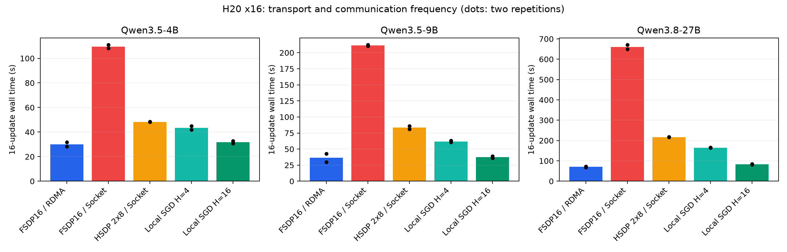

# 跨硬件低频同步是否值得：H20与Ascend 910B4多模态模型文本主干训练的系统实测

**技术报告 · 数据截止2026-10-21 · 可复现实验记录**

## 摘要

本文研究固定总卡数下，H20与Ascend 910B4混合部署是否能改善模型训练与生成更新流水线的效率。实验分为4＋4混合/同构8卡预验、8＋8混合预验，以及新架构H20同构16卡跨机对照。新架构主实验采用Qwen3.5-9B和Qwen3.8-27B文本主干，并保留Qwen3.5-4B校验。H20跨机实验已完成42次训练计时和9个生成更新配置；NPU同构16卡与新版8＋8混合组截至查询仍在排队。本文完整披露已有结果，不将未运行实验补为推测数据。

在两台H20各8卡的系统中，Qwen3.8-27B全局FSDP16每16个更新的平均时间为70.56秒；强制机间Socket后为660.09秒。采用机内8卡分片、机间复制后，Socket时间降到216.60秒；CPU/TCP每16步参数平均可进一步降到83.30秒，但改变了优化语义。Qwen3.5-9B对应时间为36.31、211.34、83.45和37.48秒。较早4＋4预验未发现混合组胜过更快同构的稳定证据。现有数据支持“低带宽下调整并行布局与同步频率具有价值”，尚不支持“异构硬件本身优于最佳同构16卡”或“达到同一模型质量更快”。

## 1. 引言与研究问题

异构资源池能够增加可用算力，但固定卡数性能不能由设备数量或通信可达性推出。两类芯片执行相同训练工作时，慢组等待、跨后端CPU中转以及优化器语义往往成为限制；生成与更新分工则可能利用两类设备不同的性能特点。本文将这些收益机制分开评估，避免把算法变化、同构扩展损失或排队条件解释为异构优势。

研究问题为：（RQ1）关闭机间RDMA后，原生全局分片的开销增长多少？（RQ2）同构系统能否利用机内分片与低频同步恢复效率？（RQ3）混合系统是否在同卡数、同数据、同策略下超过最佳同构？（RQ4）生成更新分工中的权重发布成本是否掩盖角色互补？RQ1与RQ2已有新架构16卡证据；RQ3的强比较仍缺两组结果，RQ4只有系统CE预验。

## 2. 相关工作

DiLoCo以多步局部优化和外部更新降低跨组通信频率；本文的局部AdamW后参数平均没有外部Nesterov优化器，不称为DiLoCo。[1] H2与HETHUB研究异构并行规划和跨芯片通信，其资源规模、芯片和网络前提不能直接映射到H20/910B4固定16卡实验。[2][3] AReaL-Hex及StreamRL通过生成和训练分工获得系统效率，部分主要比较采用等费用而非等卡数，也不能替代本实验的硬件对照。[4][5]

Qwen3.8官方模型卡说明其建立在Qwen3.5架构基础上；版本与后训练能力提升不等同于独立的新主干结构。[6] 因此新实验选择不同规模的混合注意力主干，而非按版本名宣称结构创新。

## 3. 实验设置与复现方法

### 3.1 模型、数据与实现

| 模型 | 文本主干参数 | 层数 | DeltaNet/完整注意力 | 16卡训练全局batch |
|---|---:|---:|---:|---:|
| Qwen3.5-4B | 4,205,751,296 | 32 | 24/8 | 32 |
| Qwen3.5-9B | 8,953,803,264 | 32 | 24/8 | 32 |
| Qwen3.8-27B | 26,895,998,464 | 64 | 48/16 | 16 |

模型参数量由配置构造meta模型计数；实际训练仅文本主干，不包括视觉编码器及MTP。Qwen3.5-9B与Qwen3.8-27B的全部ModelScope权重SHA256已与官方Hugging Face仓库清单核对一致，详细revision与文件哈希见[模型清单](../new-model-manifest.json)。较早Qwen2.5实验作为附录历史数据，不作为新架构主要证据。

数据为GSM8K公开训练集7473条、测试集1319条。性能工作负载取确定的样本顺序、截断prompt并保留最多256个监督答案token，训练序列最多512 token。3.5模型每个16更新case共65151个监督token；3.8模型因microbatch减半，共33149个监督token。不同模型的token/s不能直接代表同质量任务吞吐。

实现采用Transformers 5.2、SDPA、PyTorch FSDP2，FP32 master参数及AdamW状态、BF16计算、FP32梯度归约；CUDA环境PyTorch 2.9.1，较早NPU环境PyTorch 2.7.1＋torch_npu。没有生产推理引擎连续批处理或Qwen专用FLA优化，因此结论限于共同实现，不能视为硬件最优值。27B在CPU加载BF16权重，逐层转FP32并分片，避免初始化前完整FP32模型超过单卡显存。

聊天文本边界与token边界分别处理：模板生成的prompt文本是完整回答文本的前缀，但分别分词会出现跨边界BPE合并。监督训练按文本边界拆分后分别分词，实际生成端使用相同prompt契约。

### 3.2 硬件拓扑与通信证据

H20×16任务实际获得两个不同物理host：compute-node-bf327105与compute-node-8a5a7f70，各8卡。任务run-redacted、trial-redacted；两个pod均退出码0。日志显示默认跨机通道“via NET/IB/.../GDRDMA”；Socket配置显示“Using network Socket”及Socket通道，见[传输证据](transport-evidence.txt)。日志中列出RoCE设备仅说明设备可见，实际通道记录用于确认本次数据面。

CPU/TCP方案机内采用NCCL/HCCL，机间对应分片使用ProcessGroupGloo与主机张量。它同时包含设备/CPU拷贝、Gloo通信和写回，不能将其总耗时解释成纯网络带宽。NPU无RDMA比较是明确采用CPU/TCP的算法路径，并非声称原生HCCL具有已验证的RDMA关闭开关。

### 3.3 对照、指标与统计口径

全局FSDP16跨16卡分片；HSDP采用二维2×8 mesh，机内分片、机间复制；CPU islands机内8卡分片，机间每步交换梯度或每H步平均参数。H=1按全局监督token归一化梯度；H>1保留各岛Adam状态并等权平均参数，改变了训练轨迹。

每种训练配置重载初始权重，执行16个更新，重复2次。case时间含数据准备、更新、日志、末端跨组等待与最终交换，排除模型加载及资源排队。跨机值取全部16个rank最慢case墙钟，监督token按原生全局计数或两岛总量统计，不对各rank重复计数。表中同时披露两次原始值与均值；不报告只有两次观测无法可靠支持的显著性或置信区间。每配置的card-seconds为16乘case时间，仅是执行段资源量，不是账单。

生成更新测试用真实生成回答做CE更新，每case16更新、输出上限128 token，发布间隔4或16；frozen固定生成模型不回传权重。这不是PPO/GRPO，没有reward、KL约束或importance correction。各间隔的回答可能不同，采用实际监督token/s补充说明，不以短程CE下降证明RL质量。

## 4. 新架构H20×16训练结果

图1：柱为两次均值，黑点为两次观测。低频Local SGD与同步FSDP优化语义不同。

### 4.1 Qwen3.5-4B

| 配置 | 第1次秒 | 第2次秒 | 均值秒 | 监督token/s |
|---|---:|---:|---:|---:|
| FSDP16 / RDMA | 31.89 | 28.17 | 30.03 | 2169.67 |
| FSDP16 / Socket | 110.94 | 108.19 | 109.56 | 594.65 |
| HSDP 2×8 / RDMA | 33.08 | 30.16 | 31.62 | 2060.40 |
| HSDP 2×8 / Socket | 48.41 | 48.17 | 48.29 | 1349.24 |
| CPU/TCP梯度同步 H=1 | 94.08 | 87.52 | 90.80 | 717.50 |
| 参数平均 H=4 | 44.93 | 41.83 | 43.38 | 1501.80 |
| 参数平均 H=16 | 32.82 | 30.67 | 31.74 | 2052.44 |

### 4.2 Qwen3.5-9B

| 配置 | 第1次秒 | 第2次秒 | 均值秒 | 监督token/s |
|---|---:|---:|---:|---:|
| FSDP16 / RDMA | 42.71 | 29.91 | 36.31 | 1794.20 |
| FSDP16 / Socket | 212.16 | 210.53 | 211.34 | 308.27 |
| HSDP 2×8 / RDMA | 34.66 | 31.72 | 33.19 | 1962.92 |
| HSDP 2×8 / Socket | 85.96 | 80.94 | 83.45 | 780.69 |
| CPU/TCP梯度同步 H=1 | 162.88 | 153.57 | 158.22 | 411.76 |
| 参数平均 H=4 | 63.11 | 60.74 | 61.92 | 1052.11 |
| 参数平均 H=16 | 38.88 | 36.07 | 37.48 | 1738.47 |

### 4.3 Qwen3.8-27B

| 配置 | 第1次秒 | 第2次秒 | 均值秒 | 监督token/s |
|---|---:|---:|---:|---:|
| FSDP16 / RDMA | 72.69 | 68.44 | 70.56 | 469.77 |
| FSDP16 / Socket | 670.43 | 649.76 | 660.09 | 50.22 |
| HSDP 2×8 / RDMA | 61.95 | 59.63 | 60.79 | 545.30 |
| HSDP 2×8 / Socket | 215.83 | 217.37 | 216.60 | 153.04 |
| CPU/TCP梯度同步 H=1 | 460.02 | 474.69 | 467.36 | 70.93 |
| 参数平均 H=4 | 164.83 | 165.22 | 165.02 | 200.87 |
| 参数平均 H=16 | 82.28 | 84.32 | 83.30 | 397.94 |

### 4.4 传输与布局的贡献

全局FSDP关闭RDMA后的平均耗时增长为3.5-4B的3.65倍、3.5-9B的5.82倍、3.8-27B的9.36倍。模型规模增大时，层级参数all-gather/reduce-scatter的数据量增加，在固定短序列计算量下通信影响更明显。此趋势来自本次特定网络与实现，不能线性外推到其他序列长度、模型或集群。

在Socket下，将全局FSDP改为机内分片/机间复制，三个模型耗时分别减少约55.9%、60.5%、67.2%。该改变保留全局同步优化器语义，说明布局调整本身即可缓解低带宽影响。RDMA下9B和27B的HSDP均值也低于全局FSDP，而4B略高，说明最佳并行策略随规模变化。

每16步参数平均相对Socket HSDP还可减少约34.3%、55.1%、61.5%的时间，但不能与同步训练做同质量速度对比。尤其该case只有16步，H=16只在末尾交换一次，验证的是通信摊薄的有利短程边界，不能代表长期收敛或故障恢复表现。

## 5. 生成更新流水线与发布频率

| 模型 | H=4 秒 | H=16 秒 | 固定教师秒 |
|---|---:|---:|---:|
| Qwen3.5-4B | 209.41 | 97.48 | 66.14 |
| Qwen3.5-9B | 363.98 | 135.20 | 67.50 |
| Qwen3.8-27B | 915.92 | 321.87 | 130.87 |

上述均为两台H20的8卡生成/8卡训练，单次观测，包含最终BF16发布。27B每次完整权重发布约53.79GB文本参数，9B约17.91GB，4B约8.41GB。降低发布频率能摊薄CPU物化、哈希、TCP发送和加载成本；固定教师取消权重回传，但任务语义也随之改变。完整checkpoint包含额外分支的文件大小不应代替本次文本参数发布量。

27B的H=4总耗时915.92秒，H=16约321.87秒，固定教师约130.87秒。固定教师适用于离线蒸馏产数、伪标注或judge池，不能与动态策略RL视为相同实验。较早分块发布没有获得稳定加速，说明减少消息数量不足以消除CPU打包与重复拷贝开销。

## 6. 异构预验及尚缺对照

### 6.1 已完成4＋4 / 同构8卡预验

Qwen3.5-4B八更新预验中，混合组每步同步为101.63秒，每8步参数平均为24.58秒；同构H20×8与910B4×8分别19.20、18.70秒。生成更新分工每4步逐参数发布的较好混合方向为44.24秒，同构NPU分工为40.70秒。这些值属于更早实验、较短case和不同global batch，不能与本报告16卡值直接拼接；它们只说明前置实验未证明异构绑定的优势。完整矩阵见[历史组合报告](../../combination-comparison.md)。

### 6.2 已完成8＋8早期预验

早期H20×8＋910B4×8两个任务双方阶段0–11均code=0，worker退出码0。已完整回收的Qwen2.5性能为：每步同步170.10/200.35秒，H=4参数平均59.51/93.04秒，H=16参数平均33.17/54.92秒，每case64103监督token。重复波动较大，后半程新架构详细计时未全部导出，不能从完成事件恢复缺失数字。因此这些结果以附录历史证据保留，不作为新模型主结论。

### 6.3 新模型强对照的覆盖率

| 实验臂 | 资源 | 截至查询状态 | 可用于结论的结果 |
|---|---|---|---|
| H | H20×16，两台8卡 | done，两个pod退出0 | 3模型×7训练配置×2重复；9流水线配置 |
| N | 910B4×16，两台8卡 | started，无worker | 尚无新模型结果 |
| M | H20×8＋910B4×8 | started，无worker | 尚无9B/27B结果 |

因此RQ3仍未闭合。可以证明H20同构系统在Socket下存在严重扩展损失，也可以证明同构HSDP/低频同步可缓解该损失；无法证明混合组比两种调优同构更快。真实强比较必须允许N、M采用同等调参预算，并对算法语义变化补齐同质量评测。

## 7. 有效性威胁与评价边界

**统计与测量。** 每种训练仅两次，流水线仅一次，无跨日期/节点重复。首轮与重复轮存在热身差异，且参数重载不能消除所有kernel缓存。全部rank完成事件、最慢墙钟和传输日志降低了遗漏等待的风险，但无法消除资源竞争与CPU网络波动。

**模型质量。** 本文没有新模型held-out accuracy曲线、多个seed的收敛、grad一致性或time-to-quality阈值。H>1参数平均采用本岛Adam与等权参数平均，局部token量不同，不能称为等价全局AdamW。有限loss只说明当前数值没有立即异常，不能证明训练正确性或最终质量。

**模型与算子。** Qwen3.8主干配置使用qwen3_5类，文件名匹配及meta参数覆盖不能完全证明所有新配置字段已按官方语义执行；所用Transformers共同实现没有针对每一新字段独立验收。Qwen3.8指标应标为该兼容实现下的系统性能，正式质量论文还需与官方参考逐层/输出校验。专用FLA、量化、生产推理服务和长上下文可能改变设备排序。

**比较公平性。** 27B采用更小global batch，跨模型耗时不能直接比较；同一模型各配置数据量相同。本文不把Local SGD对全局Socket FSDP的加速归为硬件贡献，也不以固定教师代替在线RL。资源排队时间与执行性能分开报告，没有设备单价，不能计算费用优势。

**可靠性。** 已有启动失败归因于节点TopologyAffinityError与早期独立HCCL root端口冲突；这些启动故障没有进入性能样本。本文未做训练中断、幂等恢复、队列背压、跨区域链路、故障恢复或长期网络竞争实验。

## 8. 讨论与结论

无RDMA环境下“有一战之力”的核心机制，是让大多数collective留在机内、降低必须穿过机间链路的数据频率，而不是混入另一类芯片。新架构实测显示，该机制对27B规模尤其重要：同构HSDP和Local SGD都能显著缓解全局Socket分片的损失。部署建议应先优化同构并行策略，再检验异构组是否仍能超过其最优基线。

当前可以建立一个可复现的系统结论：固定H20×16、共同SDPA/FSDP实现与短序列工作负载下，RDMA、机内分片和同步频率均对吞吐有显著数值影响。现阶段无法建立异构芯片优势或同质量训练加速结论。最有价值的后续实验是完成NPU与新版混合组，补齐同策略对照和质量曲线；若最终只能胜过未经布局优化的Socket FSDP，不宜将其包装为异构训练收益。

## 9. 复现资产与后续验收

数据文件：[全部原始事件](events.jsonl)、[训练CSV](training-metrics.csv)、[机读训练指标](training-metrics.json)、[通信日志摘录](transport-evidence.txt)、[图1 SVG](training-walltime.svg)。代码与不可变模型revision见上级code/、code-sha256.json、new-model-manifest.json。原始bootstrap日志仅留在临时证据目录，未复制可能包含敏感环境信息的启动全文。

后续验收需完成三臂同模型/同global batch/同优化策略，至少3个seed的固定质量阈值曲线，分别报告同步与Local SGD；对新版模型核对官方参考输出与梯度；补充长序列/长轨迹、生产kernel和发布分阶段profile。只有在计入传输、等待与最终发布后，同质量时间仍超过两种同构中更快者，才支持扩大异构部署。

## 参考文献

[1] DiLoCo: Distributed Low-Communication Training of Language Models. https://arxiv.org/abs/2311.08105
[2] H2: Towards Efficient Large-Scale LLM Training on Hyper-Heterogeneous Cluster over 1,000 Chips. https://arxiv.org/abs/2505.17548
[3] HETHUB: A Distributed Training System with Heterogeneous Cluster for Large-Scale Models. https://arxiv.org/abs/2405.16256
[4] AReaL-Hex: Accommodating Asynchronous RL Training over Heterogeneous GPUs. https://arxiv.org/abs/2511.00796
[5] StreamRL: Scalable, Heterogeneous, and Elastic RL for LLMs with Disaggregated Stream Generation. https://arxiv.org/abs/2504.15930
[6] Qwen3.8-27B official model card. https://huggingface.co/Qwen/Qwen3.8-27B
[7] Qwen3.5-9B official weights. https://huggingface.co/Qwen/Qwen3.5-9B

外部论文用于研究背景，本文数值均来自本项目任务事件；不同论文中的加速比未拼接为本项目预测。
