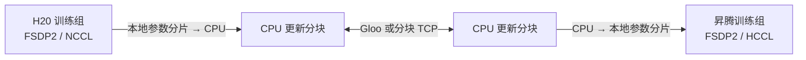

# H20 / 昇腾训练通信：支持范围与待验证条件

资料核对日期：2026-10-19。后续已申请 H20/910B4 各 1 卡，完成 HL 内不同节点的 TCP、CPU Gloo 及设备写回探针；完整训练尚未实施。实测见 [communication-results/report.md](communication-results/report.md)。

## 1. 直接回答

**标准 NCCL/HCCL 路径不提供 H20 与昇腾设备张量混合 collective。CPU 中转后的直接 TCP 与 CPU Gloo 聚合，在本次分配的 H20/910B4 两个 HL 节点上已实测通过；完整模型的异构混训、其他节点与跨 HL/LF 仍需验证。**

通信有三个独立条件：后端能处理张量、实际节点能建立连接、训练状态与更新规则一致。证明其中一个不能代替另两个。

| 路径 | 官方能力 / 源码证据 | 本环境证据 |
|---|---|---|
| H20 组内 CUDA 张量通信 | PyTorch NCCL 后端支持 CUDA collectives [C1] | 既有同机小张量探针；本项目未实测 |
| 昇腾组内 NPU 张量通信 | TorchNPU 将 HCCL 注册为 `devices=["npu"]` [C2] | 既有小型训练/分片参考；大模型跨机链路未验证 |
| H20 与 NPU 设备直接混合 all-reduce | 标准后端没有这条互操作路径 | 不作为方案依赖 |
| 双方 CPU 张量经 Gloo 聚合 | CPU `all_reduce`、`broadcast`、`send/recv` 有官方支持 [C1] | 已通过 4 KiB–256 MiB、每档 3 次 all-reduce 及设备写回；TorchNPU 2.7.1 |
| 独立 TCP 传输 | 普通主机字节传输可与设备后端分开 | 本次 HL 跨硬件直接 IPv6 TCP 通过；独立服务进程、HL↔LF 与长期连接未验证 |
| 共享 HDFS/ByteNAS 交换更新文件 | 可设计上传、聚合、发布、下载协议 | 两侧共同可读写路径、权限、吞吐与发布语义未验证 |

## 2. 具体怎样通信



组内在各自同构进程组中训练。每 H 次本地更新，固定成员一起进入外部同步轮次：

1. 检查双方使用相同的模型配置、参数 manifest、起始版本和已声明的数据/更新计划。
2. 从本地设备参数分片构造更新，转换成约定的 CPU FP32 表示。
3. 聚合同一逻辑参数区间的更新，执行约定的 outer optimizer。
4. 将新模型分片写回各自设备；全部参与组确认同一提交轮次后再继续训练。

第一版阻塞同步，不在传输尚未提交时继续修改同一份参数，也不依靠异步搬运掩盖不一致的快照。后续重叠需要单独的快照缓冲区、完成事件与版本约束。

同一参数在两侧的 CPU 数值表示可以一致；CUDA 与 NPU 上的计算轨迹不保证逐 bit 相同，需要独立的数值与收敛验收。

### 2.1 Gloo 与独立 TCP 不是同一个部署选择

- **Gloo**：现有 CPU collective 可复用。两侧需要兼容的软件栈，以及 rendezvous 和实际 peer 数据连接所需的网络可达性。仅能连接 `MASTER_ADDR:MASTER_PORT` 不够；不能把一个固定 endpoint 可达当成所有 peer 可达。
- **独立 TCP 服务**：训练进程只做设备与 CPU 的本地搬运，通信进程采用统一环境；每组向可达的聚合服务连接。可减少对 peer 互连和两侧 PyTorch 版本一致性的要求，但要实现分块、归约、校验、背压和提交；服务 NIC、CPU 与内存会成为容量限制。

两者择一作为首版。优先复用 Gloo；如果只有固定服务端口可达，则评估独立服务。HTTP 代理配置不能作为任意 worker TCP/Gloo 端口互通的证据。

### 2.2 FSDP 分片必须对齐

不能拿两侧 `rank=0` 的本地参数直接相加：两组的卡数或 placement 不同，rank 0 可能持有不同的参数区间。

首版使用相同岛大小与分片规则；对照 `tensor_name / global_shape / shard_offset / shard_length / dtype`。后续支持不同岛大小时，将本地分片重排到统一逻辑区间，聚合后再分发到本地布局。设备特有格式与 padding 不作为网络参数格式。

使用分片或分块传输，避免先在单个 leader 的设备内存中物化全部模型。更多连接只可能改善链路利用率，不能突破共享 NIC 的总带宽。

## 3. 已有项目到底支持到哪里

### 3.1 prime-diloco：CPU 外部同步有直接代码证据

核对 `src/zeroband/diloco.py` [C3]：

- `get_offloaded_param()` 在 CPU 上创建 FP32 参数与更新 buffer。
- `sync_pseudo_gradient()` 从设备本地分片构造 CPU 更新，并调用外部 `all_reduce()`。
- `sync_inner_model()` 将 CPU 外部参数复制回设备参数。

核对 `src/zeroband/comms.py` [C4]：

- 默认后端为 `cpu:gloo,cuda:nccl`。
- `_create_global_pg()` 实际创建 `ProcessGroupGloo`。
- 本地 device mesh 使用 `"cuda"`，不是通用 NPU 实现。

因此它证明 CPU 同步路线有工程先例；不能直接证明 CUDA/NPU 开箱即用。CPU DTensor mesh、NPU 本地训练与 staging、依赖和分片布局都需核对。

该版本在多次外部聚合失败后存在退回本地 pseudo-gradient 的路径；这不符合本项目首版“固定成员、完整轮次提交”的约定。复用时必须明确修改或替换该失败行为，不能把该代码直接当作本项目一致恢复证明。

### 3.2 torchft：可复用组件，尚无本环境异构验证

README 列出容错 DDP/HSDP、LocalSGD、DiLoCo 和通信/恢复组件，后两者标为 experimental [C5]。这些是优先评估的已有实现；本轮没有完成 TorchNPU 安装、调用链或跨设备集成验证。

## 4. 只有共享存储时怎么办

如果 worker 之间不能直接建链、但双方能访问共同存储，外部同步可以改为：

```text
各组上传本轮更新分块
    → 发布完整 manifest
    → 协调器读取并聚合
    → 写入新模型版本及提交记录
    → 各组下载并确认
```

这是一套新的外部同步协议，不是通过 `init_method="file://..."` 自动得到的 Gloo/NCCL 数据通信。PyTorch 的共享文件初始化用于交换建链信息，并要求文件锁语义；数据 collective 仍需要后端建立连接 [C1]。

存储方案依赖共同命名空间、权限、完整对象可见性和可靠的提交记录。HDFS、ByteNAS 与对象存储的锁、rename、条件更新语义不同，不能假定具有同一种原子发布能力。

上传和下载的大 payload、存储排队、协调器故障与初始化/恢复都计入时间。如果每轮成本过高，或根本没有可共享通道，就不应承诺联合训练；可保留独立硬件训练对照与同构低带宽实验。

## 5. 带宽、内存与慢组的账本

按原 Qwen3 模型卡参数量计算 FP32 更新；实际决策模型需要重新统计参与训练的参数。

| 参考规模 | 一份 FP32 更新 | 理想 10 Gbit/s 链路单向传输时间 |
|---|---:|---:|
| 8.2B | 32.8 GB | 26.24 秒 |
| 14.8B | 59.2 GB | 47.36 秒 |
| 32.8B | 131.2 GB | 104.96 秒 |

这是 `payload_bytes × 8 / link_bits_per_second` 的理想单向账本，不是完整 outer round，也不是实测。上传/回传、归约算法、协议、共享 NIC、CPU↔设备搬运与最慢组等待均另计。1 Gbit/s 的对应时间为上表十倍。

FP32 CPU base 参数、pseudo-gradient 与 outer momentum 三份状态合计约 `12 × P` bytes；8.2B 为 98.4 GB、32.8B 为 393.6 GB，另加快照和传输 buffer。这些状态可分片分布，但单一服务/leader 集中保存时必须规划主机内存。

不压缩时，低频同步只减少频率。单组上传的平均需求约为 `4P / (H × T_inner_step)` bytes/s，结果回传及实际聚合流量另算。需要实测 H20、NPU 的单步时间与端到端同步时间，才能选择 H；不能仅凭“每 64 步同步”判断能提速。

固定成员、固定 H 的首版仍等待慢组。给快组增加步数或让慢组退出会改变优化算法和数据权重，不能作为透明性能优化。

## 6. 什么证据才能称为“确实支持”

按顺序验收。已完成本次 HL 两个节点的身份与基础数据面、设备 FP32 张量聚合写回；未完成项仍按下述范围验证：

1. **真实不同物理节点建链**：记录平台 node identity、hostname、实际设备与接口；测试双向数据通道，而不只测 rendezvous。分别覆盖同集群与计划采用的跨集群路径。
2. **实际数据面**：CPU 小张量聚合正确；以分块方式传输较大累计 payload，记录摘要、吞吐、p50/p95 和多连接时 NIC 总流量。Gloo、独立 TCP 或存储各测自己的数据面。
3. **跨设备闭环**：H20/NPU 参数分片 → CPU → 聚合 → 写回，先对照独立 FP32 参考。包括相同布局；不同布局作为另一个验收项。
4. **故障与提交**：传输中断、重复分块、聚合后提交前失败、提交后确认前失败；恢复模型与内外优化器、数据进度到一致版本。
5. **真实 8B 训练**：记录通信与搬运全部开销、主机内存和质量；14B/32B 的容量与性能不能由 tiny probe 推断。

本次 256 MiB Gloo 操作中位耗时 344.19 ms，TCP 请求、平均与回传中位耗时 1,421.25 ms；口径不同，不据此计算纯网络加速倍数。参数分片重排、NIC 总流量、长期稳定性、恢复与收敛仍未验证。

既有 `training_infra_lab/jobs/h20-multinode-probe/inspection.txt` 中四个 rank 都报告 `compute-node-3a931df8`，只能作为同机多进程参考。本目录方案不能引用它声称跨物理机或 HL↔LF 已通。

## Sources

- [C1] PyTorch distributed 后端能力、初始化与网络接口说明，本轮读取的文档源码：https://raw.githubusercontent.com/pytorch/pytorch/v2.7.1/docs/source/distributed.rst
- [C2] TorchNPU HCCL 后端注册，读取 `master`，不是已锁定环境版本：https://github.com/Ascend/pytorch/blob/master/torch_npu/_init/registry/distributed.py
- [C3] prime-diloco CPU 参数、pseudo-gradient 与写回路径：https://github.com/PrimeIntellect-ai/prime-diloco/blob/main/src/zeroband/diloco.py
- [C4] prime-diloco Gloo global group 与 CUDA local mesh：https://github.com/PrimeIntellect-ai/prime-diloco/blob/main/src/zeroband/comms.py
- [C5] torchft 能力与实验状态：https://github.com/pytorch/torchft

以上可变分支用于能力调研。正式实现应固定 commit、版本和可复现环境，再建立运行证据。
