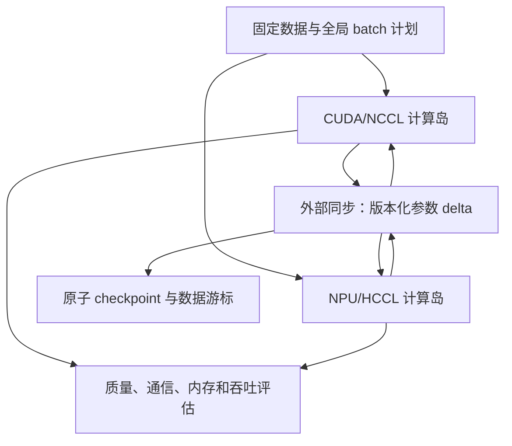

# 决策模型训练 Infra 项目方案

状态：研究与方案完成；已实现并提交独立 H20/910B4 通信探针，TCP、CPU Gloo 和设备写回通过。尚未实现 trainer 或提交真实模型训练。

立项更新：针对“H20×8＋910B4×8 优于两种同构 16 卡”的新目标，当前双训练副本方案不直接进入主实现。最新文献判断与有条件推荐的 RL 分工路线见 [heterogeneous-training-decision.md](heterogeneous-training-decision.md)。下文保留原方案作为技术参考，不视为已选定项目。

## 1. 项目定义

**项目题目：面向决策模型后训练的 CUDA/NPU 训练后端与低带宽分布式同步。**

主任务是在公开数据上训练一个 Qwen3-8B 主干的决策模型，直接输出候选答案概率，支持 Choice、Noul 和 Score。全量训练该决策模型的主干和决策 head，比较 H20 与 910B4 上的训练效率，研究不同网络条件下的同步 HSDP、Local SGD 与 DiLoCo。

主指标是 **达到同等决策质量与校准质量所需的墙钟时间**，配合有效 token/s、决策/s、暴露通信时间、bytes/update、峰值内存和恢复代价。

规模路线：

| 层级 | 模型 | 作用 |
|---|---|---|
| 正确性与低成本回归 | Laya 322M/421M，或主模型缩小配置 | 输入、loss、mask、梯度、同步与恢复验证 |
| 主实验 | Qwen3-8B 决策模型 | 在 H20/NPU 上完成真实全参数后训练与通信对照 |
| 第二规模 | Qwen3-14B 决策模型 | 验证大梯度、参数物化、不同岛大小 |
| 扩展验收 | Qwen3-32B 决策模型 | 验证大模型状态、跨节点分片与恢复；至少完成预先声明的数据训练周期 |
| 结构参考/后续负载 | Clef-Flash 9B、Clef 27B、D3 等 | 多问题共享读出、多模态和不同 attention 主干 |

模型卡的 8.2B/14.8B/32.8B 包括原模型的参数；改成决策模型后须重新统计。若删除未使用的 LM 输出层，要明确报告主干、head 和实际参与训练的参数数目，不能将冻结 LM head 算入“全参数训练”。内存初始规划按原模型参数量作保守估算，见 [research.md](research.md)。

该项目的挑战来自分布式语义、算子 backward、低通信收敛和恢复一致性，而不是单纯让模型规模更大。

## 2. 模型与训练目标

### 2.1 第一版：单问题答案 code 读出

采用 Qwen3 dense 主干，保持其 causal/GQA/RoPE 结构。输入依次是：

```text
state → question instructions → 允许的 options → 固定 read marker
```

取最后有效 read marker 的 hidden state，用小型 code head 输出固定上限的 code logits；只对该问题真实的 K 个 code 做 softmax，映射回 option ID。

建议第一版最大候选数 64，后续测试 128/255；这是本项目实验配置，不是 Qwen 或已有模型的能力承诺。固定 code 是 head 输出索引，不要求每个业务标签是 tokenizer 的单个 token。

优点：

- 避免为所有输入位置生成 `[B,L,V]` 全词表 logits。
- 正常训练整个主干和 head，仍有大模型训练负载。
- 与单问题原生 logits 基线容易逐项验证。
- 易于隔离 NPU GQA、mask 和 FSDP 问题。

不将其称为复现 Clef 或 Jev，也不以修改 head 证明通用智能提升。

### 2.2 第二版：多问题共享主干

先明确训练与推理语义，再实施优化：

- state 主干只计算一次。
- 问题可作为 branch 读取共享 causal state prefix，或由 joint schema head 读取 state hidden states。
- 问题数、选项数、read positions 用 offsets 明确映射。
- 不把任何 gold label 拼入另一题可见的输入。

参考 Clef joint schema 结构，但公开模型卡不是完整训练 recipe。采用自定义 Qwen3 joint head 时，必须以与独立问题基线的质量对照确认结构选择，不声称数学等价。

顺序执行的不同问题前缀、branch mask 和 joint head 不是同一种机制；第一轮只选其中一个，推荐 joint head。Shared prefix 分支是进阶训练内存优化候选，不与 low-communication 实验同时引入。

### 2.3 目标与实验臂

主要训练臂：

1. 硬标签 CE：真实标签建立监督基线。
2. soft-CE 蒸馏：可选离线教师分布，严格保留 teacher/version/schema。
3. RLCD：后续比较对校准和决策质量的收益，不作为实现前提。

主数据采用按案例平均的目标，案例内题目均分权重；任务混合权重固定写入 manifest。Score 用离散等级分布训练，输出期望评分。

敏感归约、log-softmax 和质量统计使用 FP32。不同精度的 kernel 方案必须核对 forward、input/weight gradients 和至少一次 optimizer update。

## 3. 真实训练负载

### 3.1 数据集

来源与规模见调研报告 [S30]–[S32]。

| 数据 | 决策任务 | 负载价值 |
|---|---|---|
| MASSIVE | 英文、中文和其他语言的 intent Choice | 可扩展真实样本数、不同语言 token 长度、候选数与非 IID |
| HelpSteer2 | 对 response 的多个评分维度作 Score | 同一 state 多个问题、评分 loss、长 response、case 权重 |
| ContractNLI | 文档级 Entailment/Contradiction/NotMentioned | 真实长文、多个假设、证据截断和重计算 |

首轮建议选 MASSIVE 的 12 个语言配置，必须包含 en-US、zh-CN；官方每语言 train 11,514 条，合计 138,168 条，按数据卡推导，下载后校验实际统计。平行翻译不能作为独立原始案例随机混入 train/dev/test。

HelpSteer2 的五个评分维度属于同一原始 prompt-response；多个 response 若共享 prompt，切分时按 prompt 分组。ContractNLI 以文档分组，保留官方划分，不能利用 test 证据做候选选择或训练输入裁剪。

不使用人工制造的长 padding、重复短样本或生成题目来声称大规模真实训练。数据增强、选项排列和候选子集都可以研究，但单独披露原始案例数与增强决策数。

### 3.2 数据策略

- 固定 dataset/model revision、schema 版本、过滤规则和 manifest hash。
- 候选数实验使用固定的真实候选全集或预先声明的子集方案。
- 候选负采样不利用 test gold；包含真标签的训练采样与全候选测试需分别报告。
- 报告各样本真实 token length、截断状态、选项描述是否仍可区分。
- 预处理一次，缓存只读 shards；训练期间本地预取。
- 按长度分桶，保证不同 rank 每个 update 的累积窗口与有效权重一致。
- 分桶只改变训练顺序时也需记录；语义正确性对照使用相同预先分配的样本。

### 3.3 长序列对照

建议先按 512/1024/2048/4096/8192 的容量上限分组，实际长度来自原始文本。只报告真实有效输入 token；不把所有样本补到 8192 当作长文训练吞吐。

大规模实验不自动使用所有长文。建立短文本算子/通信负载和长文算子/激活负载两个曲线，可揭示瓶颈从通信向计算或内存的变化。

## 4. 系统架构



这张图表示最终扩展架构。首轮使用同构 H20 岛或同构 NPU 岛，跨 CUDA/NPU 同步只在各自训练正确性与同构低通信实验通过后做。

### 4.1 后端接口

实现窄后端接口，覆盖：

```text
device / autocast / synchronize
memory stats / profiler
attention forward+backward
fused optimizer 可选
collective backend
checkpoint tensor staging
```

模型、目标与样本计划共用；不同硬件的软件版本可不同，但锁定并记录差异。不将所有 CUDA API 文本替换成 NPU API 当作移植完成。

### 4.2 并行结构

同一模型在每个计算岛中有完整的逻辑副本；岛内部的参数可由 FSDP2 分片。

| 模式 | 岛内 | 岛间 | 训练语义 |
|---|---|---|---|
| 单岛基线 | DDP 或 FSDP2 | 无 | 正常同步训练 |
| 同步 HSDP | FSDP2 分片 | 每次 update 同步 gradient shards | 同一目标的同步数据并行 |
| Local SGD | 岛内同步 | 每 H 次 update 平均模型 | 改变优化路径 |
| DiLoCo | 岛内同步 AdamW | 每 H 次 update 聚合 delta，outer momentum | 改变优化路径 |
| 压缩 DiLoCo | 同上 | 对 delta 做可恢复压缩 | 额外数值近似 |

不将一个全局 FSDP process group 同时跨 H20/NPU；NCCL 与 HCCL 属于各自的岛内部。标准后端不提供 CUDA/NPU 设备张量混合 collective。

异构外部交换采用 CPU FP32 staging，再复用 CPU Gloo 或实现独立分块 TCP 服务。本次 HL H20/910B4 两个不同节点的 TCP、CPU Gloo 和设备写回已实测通过，见 [通信实测](communication-results/report.md)。这尚未覆盖参数分片重排、HL↔LF 数据面和完整训练闭环，不能承诺现成异构训练支持。Gloo 需要 rendezvous 与 peer 数据连接均可达；两组的逻辑参数分片必须对齐。搬运、主机内存、聚合与回传均计入开销。

若只有共同 HDFS/ByteNAS 可访问，外部同步须改为上传、聚合、发布、下载协议；共享文件初始化不等于 collective 数据面可通。通信支持矩阵、容量账本和验收条件见 [communication-feasibility.md](communication-feasibility.md)。同步 HSDP 基线先限于同构；异构逐步梯度同步需要另行实现与验证。

### 4.3 关键工程模块

| 模块 | 核心职责 | 主要挑战 |
|---|---|---|
| Model adapter | 主干、code/joint head、实际 trainable 参数 | 输出 head、GQA/mask、unused 参数 |
| Batch planner | 分桶、任务混合、rank 分配、累积窗口 | 不同案例权重、长尾、无重复/漏样本 |
| Loss contract | sum/weight、有效选项 mask、全局 normalize | 分片与平均的 divide factor |
| Island trainer | FSDP2、AMP、recompute、optimizer | 初始化峰值、通信累积、全局 clipping |
| Outer optimizer | Local SGD/DiLoCo、delta、m/v 策略 | base version、round、head 与主干更新 |
| Transport | 分块、校验、带宽限制、重试 | 真正网络流量、staging、去重 |
| Checkpoint | weights/optimizer/RNG/plan/scheduler/outer state | 一致快照、原子发布、恢复 |
| Evaluator | 分类/评分/校准与系统报告 | 达到同等质量的时间 |

## 5. 有挑战的实现重点

### 5.1 主挑战：低带宽下同步边界与恢复

外部同步使用版本化参数 delta：

```text
run_id / round_id / base_model_version
model_manifest_hash / tensor_name / shard_range
dtype / byte_length / payload_digest
data_plan_cursor / completed_inner_updates
```

外部服务器或 peer 集合先接收完整分块并校验，完成聚合后生成新版本，最后发布 commit record。各岛只接受当前约定版本；重试的同一 shard 不重复计算。

首版采用固定成员、阻塞 outer commit。故障时恢复到上一个完整提交轮次，允许重放未提交训练，但保证已提交数据进度与 optimizer 状态一致。之后再加入单岛掉线、成员更新和有限过期容忍。

恢复需要同时覆盖：

- 每岛本地 Adam m/v 与 update count。
- 外部 Nesterov momentum 与 θ_t。
- 数据 shard、sampler/packing cursor、任务混合与 batch plan。
- Python/NumPy/设备 RNG；选项顺序与训练噪声。
- precision 状态，如 scaler 或 FP8 amax。
- manifest、轮次和模型配置。

仅能加载 model.safetensors 不算训练恢复；仅保存模型而丢失 optimizer m/v 会改变训练过程。

### 5.2 NPU 实质优化

先用 profiling 选一个真实热点，目标优先为：

1. Qwen3 训练 GQA attention 的融合与正确 mask。
2. RMSNorm/RoPE/SwiGLU 的布局与融合，覆盖 backward。
3. FSDP2 混合精度、重计算和通信调度。

Laya 可用于 noncausal/local-window attention 的补充测试。其候选 head 通常较小；如果 profiling 显示 head 占比很低，不为了“有 kernel”而优化一个对总时长无意义的 scorer。

### 5.3 H20 实质优化

先比较 microbatch、选择性重计算、FSDP reshard/prefetch、融合 optimizer 与实际 flash attention 路径。FP8 作为独立进阶实验，不与低频同步首次上线同时引入。

8B 在单卡上可行的 head-only/LoRA 对照可证明通信成本降低，但主线保留全参数主干训练，避免只训练几百万参数却按 8B 模型宣传训练规模。

### 5.4 自适应通信策略，后续研究点

策略可根据实测：

```text
相邻轮次的主干/head delta 范数、方向差异
暴露同步时间 / 计算时间
各语言/任务的 held-out loss 与 ECE
可用内存、失败与重试率
```

在固定候选 H 中选择，不让 H 逐轮任意变化。建议先评估 H=4/16/64；是否增加到更大 H 由足够的 outer rounds 与收敛证据决定，不直接照搬论文 H=500。

Head 与主干的不同同步频率是独立实验臂。即使 head 同步频繁，也不自动校正已经分叉的主干；需要保存各组件版本与一致更新规则。

## 6. 低带宽实验设计

### 6.1 真实网络与受控网络

先测实际同机、同集群跨机、HL↔LF 的通信，确认允许连接的 transport。大 payload 与小 bucket 都测，记录 p50/p95、NIC 总流量与最慢 rank。

先验证双向数据通道与真实节点身份，再决定采用 Gloo、固定服务端口的 TCP 聚合或共同存储。按 8.2B 参数计算，一份 FP32 更新为 32.8 GB，在理想 10 Gbit/s 链路上的单向传输已需 26.24 秒；这尚未包括回传、设备搬运和归约。用完整 outer round 时间与慢组单步时间选择 H，不能仅凭减少同步次数推断训练加速。

受控条件可以选择应用层真实分块发送、token-bucket 限速，使 payload 真正经过通信通道。建议限速档位 1/5/10/25 Gbit/s；这些仅为实验条件，不是已知集群带宽。

- 如果使用 TCP transport 和流量整形，明确报告为 TCP 后端实验。
- 不把 TCP 的 `tc` 限速外推为 RoCE/NCCL 限速。
- RDMA 实验需平台允许的测试方法；不修改共享节点 NIC/交换机设置。
- 人工 sleep 只能作为同步延迟控制，不作为带宽测量或主结果。

### 6.2 可比较基线

第一组保持训练目标：

- 单岛正确同步。
- 全局 FSDP2 作为诊断对照；如果明显不适合低带宽，不作为唯一性能基线。
- 调优同步 HSDP，包括复制维度的梯度累积。
- 固定全局 batch，不通过增大 batch 偷换吞吐收益。

第二组改变优化路径：

- Local SGD。
- DiLoCo FP32 外部 delta。
- 同一 DiLoCo 设置下的 BF16、INT8+error feedback 对照。
- 节点异常、超时与恢复。

每组重新加载同一初始权重，使用固定来源数据与任务配比。按总数据曝光量和墙钟时间分别比较；不同算法不只按“optimizer steps”比较。

### 6.3 时间分解

每个真实更新/outer round 记录：

```text
input wait
forward / backward / optimizer
island collectives
delta construction / CPU staging
encode/compress / network / decode
outer update / redispatch
checkpoint staging / write / commit
evaluation
```

异步路径用 timeline 看关键路径；不要把有重叠的时长简单相加。performance benchmark 降低插桩密度，profile run 单独归档。

端到端测量计入数据搬运、正常同步、重试与恢复；冷启动/下载单列。另给纯训练 kernel 口径，以定位优化收益。

### 6.4 质量约束

建议预先声明的验收门槛，属于设计目标而非预测：

- Accuracy/Macro-F1 相对调优同步基线下降不超过 1 个百分点。
- ECE 增量不超过 0.02，并同时报告 NLL/Brier。
- Score MAE 与少数语言/少数类不得出现未解释的明显退化。
- 低带宽条件下到达这些目标的时间优于调优同步基线。
- 未达到质量门槛，则把该 H/压缩配置判为失败，保留结果。

阈值由验证集挑选，测试集一次确认；最少运行多个随机种子，建议主结论 3 个 seed。没有足够数据或多个 seed 时，不宣称稳定优势。

## 7. 分阶段计划

下列周期为执行顺序与规划参考，真实耗时取决于队列和单岛性能，当前没有训练时长估计。

| 阶段 | 建议资源规模 | 工作 | 阶段产物 |
|---|---|---|---|
| P0 环境和拓扑 | 每种卡 1–2 张，真实跨机探针 | 环境锁定、节点身份、collective payload 曲线 | 环境与通信报告 |
| P1 训练正确性 | 小配置 + 每种卡 2–4 张 | mask/loss/梯度/归一化/恢复 | 正确性证据与窄 trainer |
| P2 8B 单岛完整训练 | H20 4/8 张；NPU 4/8 张 | 后训练、batch、精度、profiling | 可用决策权重、校准与单岛基线 |
| P3 8B 低通信 | 同构双岛，8/16 张起 | HSDP、Local SGD、DiLoCo、受控带宽 | 同质量时间与流量曲线 |
| P4 14B 扩展 | 每岛约 8 张起 | 初始化/分片、非 IID、断点恢复 | 第二模型规模的验证 |
| P5 32B 与异构扩展 | H20 16/32 张分岛；NPU 16 张作单岛容量验证 | 大状态、恢复、可选异构 outer sync | 大模型边界与扩展报告 |
| P6 结构与贡献整理 | 使用前面获胜配置 | joint head、可选多模态、上游贡献 | 可复现 recipe、PR 与报告 |

资源不是全开全用：

- HL 的小任务优先背景适合环境、算子和回归实验；调度政策以平台实际确认为准。
- LF H20 优先做大规模同构实验，先 16 张，再 32 张。
- NPU 先 8B 双岛，14B 若每岛需要 8 卡则用 16 卡；32B 16 卡可能只能组成一个岛。
- 不因有 56 张算术剩余 H20 就承诺能获得 56 张同拓扑节点。
- 同一模型的多 seed 与参数对照使用独立实验；利用多卡并行跑独立实验，也是一种资源使用方式。

## 8. 交付物与协作边界

本轮已交付：

- `research.md`：调研、平台证据、硬件优化与通信问题。
- `proposal.md`：模型任务、训练系统与实验/验收设计。
- `README.md`：目录入口与协作说明。

实施阶段的建议目录：

```text
laya/
  docs/                 训练语义与实验记录
  configs/              固定模型、目标、精度、并行与数据配置
  data/                 数据 adapter、manifest、batch planner 源码
  models/               code/joint head adapter 源码
  backends/             CUDA 与 NPU 窄接口
  distributed/          island trainer、outer optimizer、transport
  checkpoint/           版本化保存、加载与 round commit
  evals/                任务与系统指标
  tests/                具有独立参考的正确性验证
```

权重、数据缓存、profile 原始输出、临时任务 payload、测试运行缓存不放入共享代码目录；使用独立 run 目录或经确认的个人存储。每次执行打包自包含源码，避免远程 worker 假设共享本地工作区。

与另外两个目录的边界：

- 不修改、移动、清理它们的文件或任务。
- 不复用另一个 AI 的运行状态作为本项目状态。
- 可只读参考既有归档，但当前结论须标记来源与验证范围。
- 对同一上游 API/kernel 的贡献先确认所有权，再实施。

## 9. 项目价值与上游贡献

适合训练 Infra 简历与技术展示的证据：

1. 在 8B/14B 真实后训练任务中，证明 CUDA/NPU 的同目标训练、反向与恢复正确性。
2. 用 profile 定位暴露通信或具体 NPU 算子，完成可复现的前后对照。
3. 在明确的低带宽条件下，以相同质量目标报告训练时间、通信体积与恢复代价。
4. 用 32B 给出内存/拓扑扩展边界，而不是仅报告 tiny model microbenchmark。
5. 向 Laya、TorchNPU、torchft 或其他适合的上游提交范围清晰的改动。

优先贡献接口：

- Laya 的分布式/决策数据与 loss contract、NPU 正反向路径。
- PyTorch/torchft 的决策训练负载适配和恢复测试。
- TorchNPU 的真实模型 kernel/mask/backward 问题与精度验证。

vLLM/vLLM-Omni 属于最终推理交付接口：先导出权重、head 与校准 contract，再验证推理读出概率一致。首版采用新的 head 时，上游 vLLM 现有 Qwen 首 token 路径不会自动支持，需后续插件或专用读出适配。

**建议先实现 P0–P3 的 8B 核心闭环，再推进 14B、32B 和异构同步。** 单纯堆叠 FSDP、FP8、DiLoCo、异步通信与多模态，会让出错归因和收益验证变得困难；每项技术都应有独立基线和失败记录。
